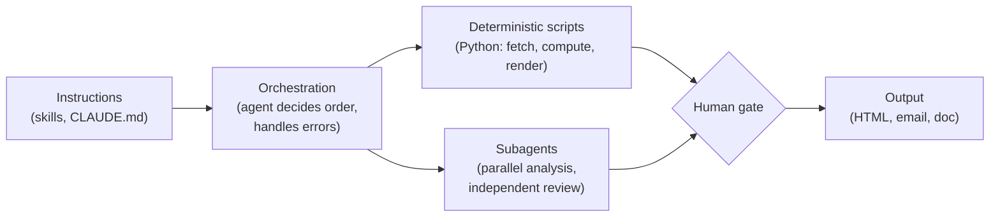

### Hi, I'm XJ 👋

Finance executive who designs agentic systems. VP, Corporate Development & Finance at Apex.AI. Before that I was an institutional investor. CPA · CFA · Stanford GSB.

I'm not a software engineer. I design the systems, meaning the architecture, data model, and quality bar, and AI coding agents (mostly [Claude Code](https://claude.com/claude-code)) write most of the code. This profile is where those builds live.

**Design principle:** push computation into deterministic code, keep the LLM for judgment, and put a human gate wherever an error would be expensive.

---

### 🔧 Automation: take the manual work out

| Build | What it does | Stack |
|---|---|---|
| [**newsletter-digest**](https://github.com/xj-2045/newsletter-digest) | Pulls the last 24h of newsletters from Gmail, analyzes each one in a parallel subagent, and emails a single HTML digest | Claude Code skill · subagents · Gmail MCP · Python · Resend |
| [**narrative-thesis**](https://github.com/xj-2045/narrative-thesis) | Stock research: scrapes 6 months of Reddit and X, then writes a 1-pager of top news, bull theses, and bear theses with source links | Claude Code skill · Python · Apify · python-docx |

### 🧠 Systems: context, memory, orchestration

| Build | What it does | Stack |
|---|---|---|
| **Personal OS** *(private)* | An AI-native operating system for my work and life: 20 skills, 12 subagents, hook-driven context injection, typed memory with a linting agent, and generated dashboards for daily, weekly, and monthly reviews | Claude Code · Python hooks · Markdown/Obsidian · Git · MCP |
| **Weekly Wall** *(private)* | One interactive page covering the week from people I follow on X, podcasts, YouTube, and 70 WeChat feeds | Apify · RSS / iTunes API · self-hosted werss (Docker + SQLite) · Python |
| **AI economics wiki** *(private)* | LLM-maintained knowledge base with proposal-gated ingest (the agent proposes, I approve) and local semantic search over ~1,500 notes | Markdown · QMD · Mermaid argument maps |
| [**Forking Paths of Ideas**](https://github.com/xj-2045/forking-paths-of-ideas) · [live](https://forking-paths-of-ideas.vercel.app) | Interactive map of 50+ intellectual movements and 137 thinkers, with a bring-your-own-key Claude fallback for anyone not in the dataset | JavaScript · Tailwind · Claude API · Vercel |
| **Fitness tracker** · [live](https://fitness-tracker-xj.vercel.app) | Strength and Hyrox-readiness dashboard built on my workout log | Next.js · React · TypeScript · Tailwind · Recharts · Hevy API · Vercel |

### 🛡️ Trust: evaluation and adversarial review

| Build | What it does | Stack |
|---|---|---|
| **Stage-gate review system** *(private)* | Six reviewer agents critique a high-stakes document in a fixed order: substance first, readability last. Each agent has a pass/fail gate, every critique must cite a source (anti-fabrication rule), and a failed gate re-runs only that gate after repair | Claude Code subagents · Python linter · structured corpora |
| **AI-native finance function** *(work)* | Weekly reporting from source data to board-ready output, investor relationship management, and an auditing agent that catches errors before they reach the board | LLM agents · finance data stack |

---

✍️ Writing on the economics of AI at [**AI P&L**](https://aipnl.substack.com) · 🌐 [www.xjzhang.com](https://www.xjzhang.com) · 💼 [LinkedIn](https://www.linkedin.com/in/xingjianzh/) · 𝕏 [@xing_roads](https://x.com/xing_roads)
